# What2Do


**What2Do** est une application web qui permet aux utilisateurs de découvrir des idées d’activités et d’événements à Genève et dans ses environs. Que ce soit pour une sortie sportive, un concert ou simplement une envie de bouger le week-end, l’application propose des suggestions pour t’aider à choisir quoi faire.

---

## Installation locale

### 1. Restaurer la base de données

Avant de lancer l’application, il faut télécharger mongoDumb pour pouvoir importer la base de donnée pré-remplie. Pour ce faire, il faut effectuer la commande suivante :

```bash
.\mongorestore.exe "chemin\vers\le\dossier\what2do_db"
```

### 2. Lancer le backend

```bash
npm start
```

### 3. Lancer le frontend

```bash
Ionic serve
```

## Fonctionnalités principales

### Page d’accueil — Liste d'événements

L’application s’ouvre sur une première page qui rassemble l’ensemble des événements à venir. Grâce à une barre de recherche et à un système de filtres par catégories, il est possible de trouver rapidement un événement précis.

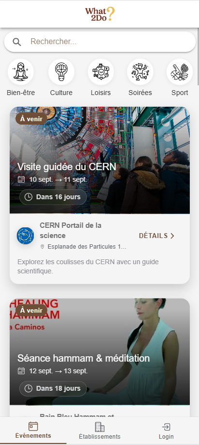

Lorsqu’on clique sur l’un d’eux, une page de détails s’affiche, offrant toutes les informations le concernant.

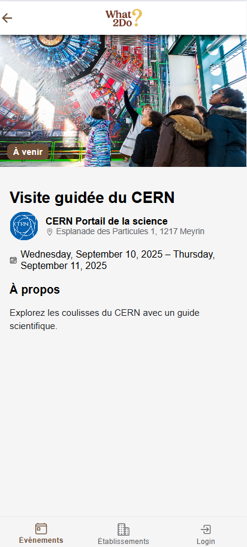

### Liste d'établissements

La seconde Tab fonctionne sur le même principe, mais cette fois-ci pour les établissements. On peut également effectuer des recherches et filtrer les résultats par catégories.

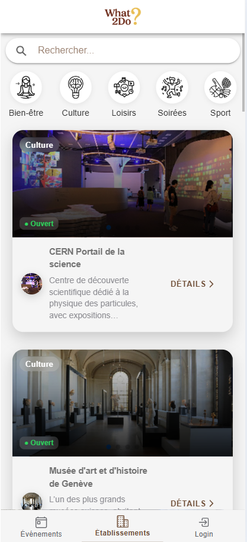

Un clic sur un établissement ouvre sa page de détails, où toutes ses informations sont consultables.


### Création d'un compte

La création d’un compte est possible aussi bien pour un utilisateur que pour un établissement, grâce à un champ « type de compte » permettant de différencier les deux. Après avoir rempli et envoyé le formulaire, le compte est créé.

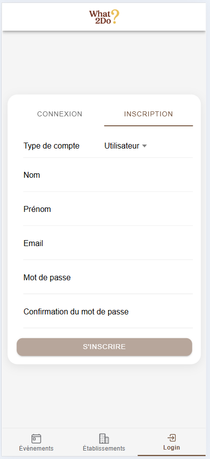
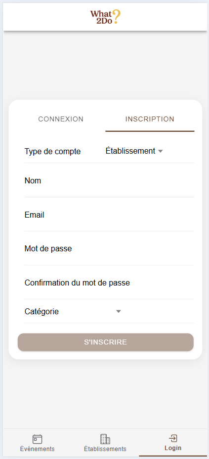

Pour valider l’adresse e‑mail, il faut accéder aux logs du backend. En cliquant sur le lien qui y apparaît et, depuis la boîte mail fictive qui s’ouvre, confirmer l’adresse mail.

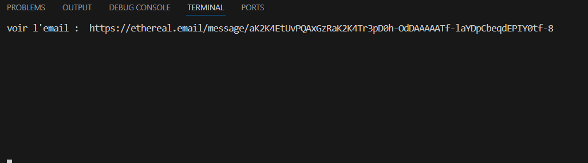
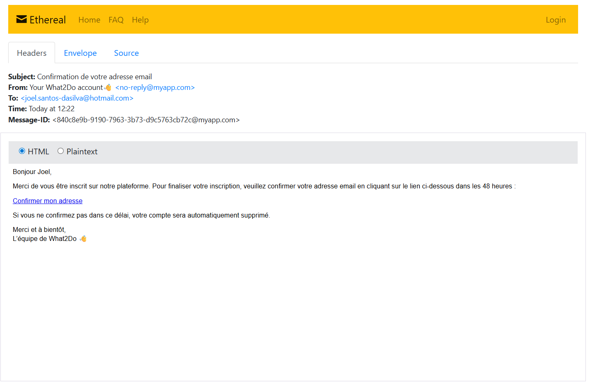

Une fois cette étape effectuée, la connexion via le formulaire de login devient possible.

### Login

Pour se connecter, il suffit de saisir l’adresse e-mail et le mot de passe associés à son compte. **Attention à bien spécifier le type de compte Utilisateur / Établissement !**

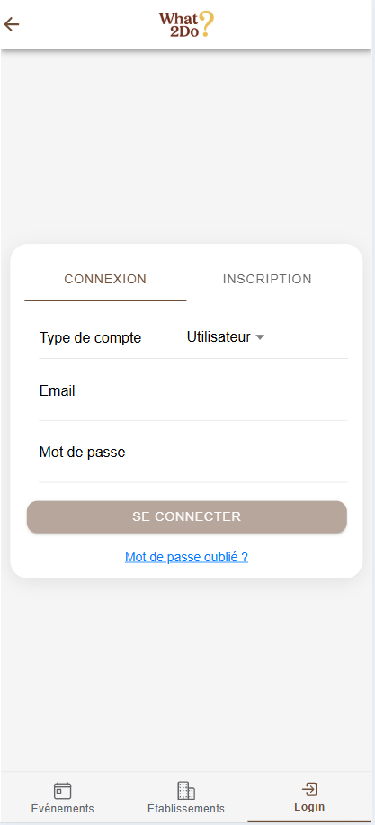

### Mot de passe oublié ?

En cas d’oubli de mot de passe, il suffit de cliquer sur le lien **"Mot de passe oublié ?"** et la page suivante s'affichera.

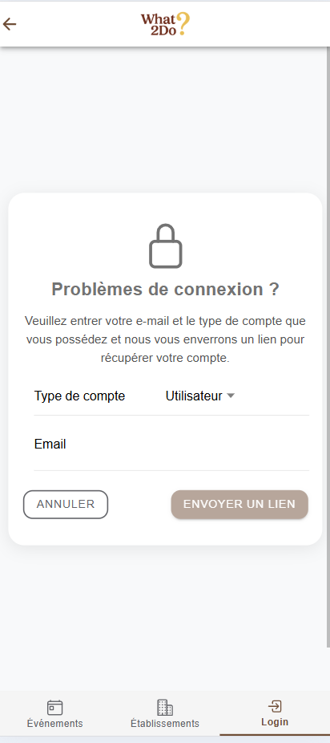

Il suffit d’indiquer le type d’utilisateur et l’adresse e‑mail, puis d’envoyer la demande. Un lien apparaît alors dans les logs de la base de données.

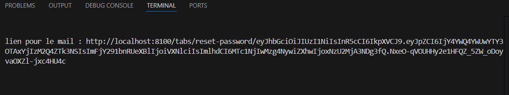

Le lien redirige vers la page de réinitialisation du mot de passe.

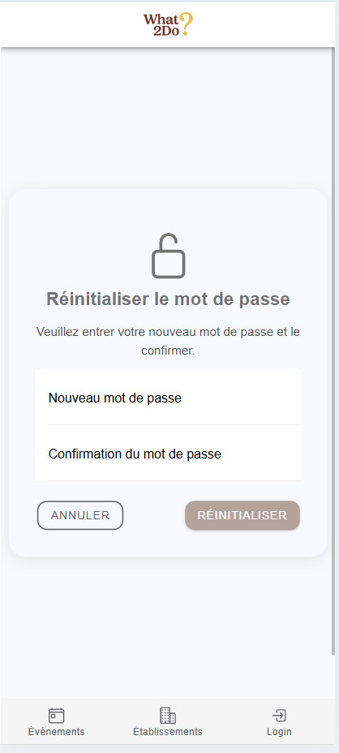

Une fois le nouveau mot de passe saisi et confirmé, il est enregistré.

### Gestion profile utilisateur

Une fois connecté à un compte utilisateur, on accède aux informations personnelles, aux commentaires et à la liste des favoris.

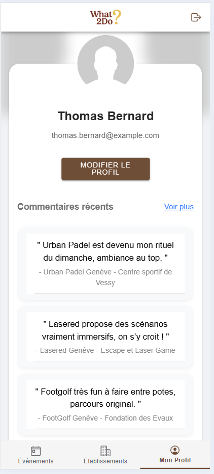

Depuis cette interface, il est possible de modifier son profil (nom, prénom et photo) ou, en cliquant sur « voir plus », de consulter l’intégralité des commentaires laissés.

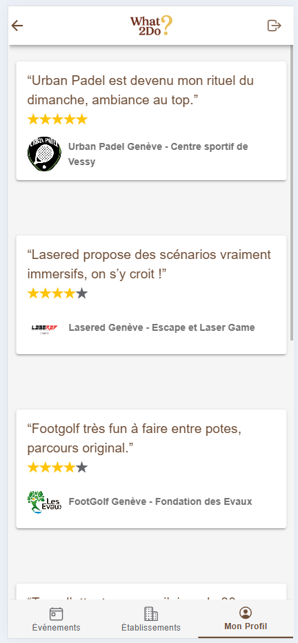

### Gestion profile établissement

La connexion à un compte établissement donne accès à toutes les données propres à celui‑ci ainsi qu’à la liste de ses événements.

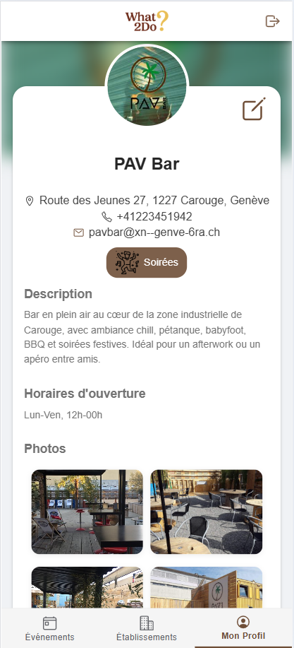
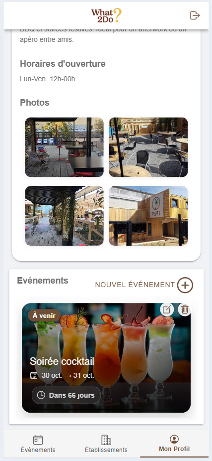

Un bouton en haut à droite permet de modifier les informations de l’établissement.

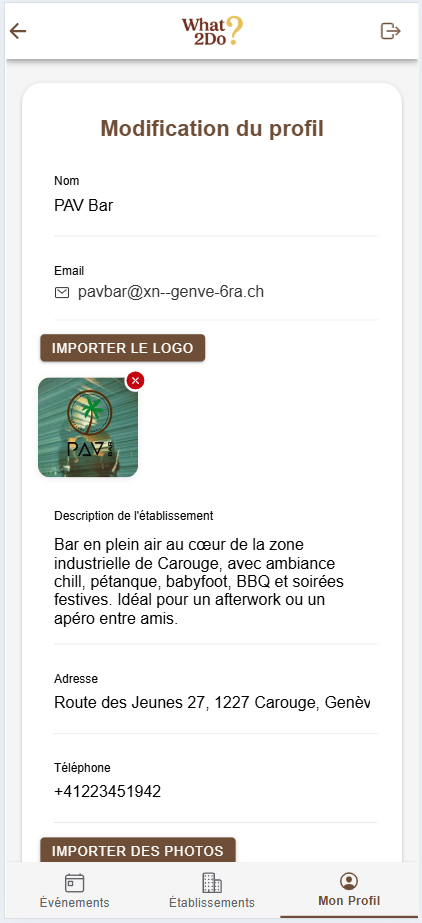

Depuis la section des événements, on peut en créer de nouveaux via le bouton « Nouvel événement + ».

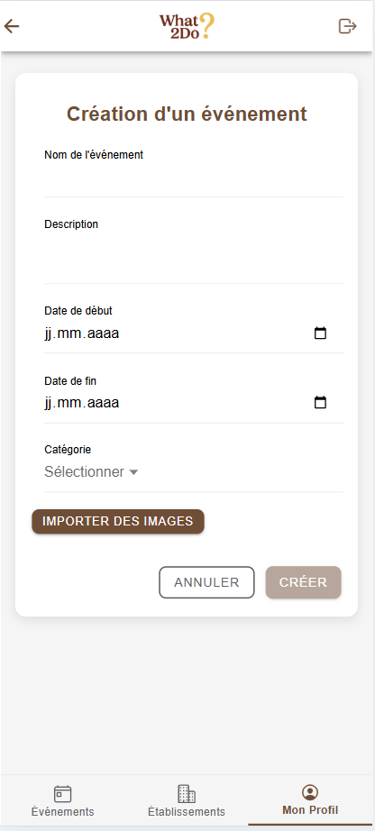

On peut également les modifier

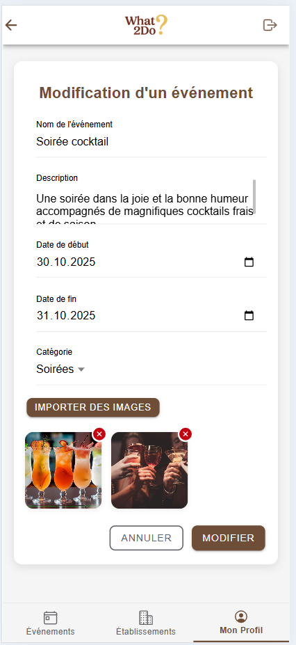

ou les supprimer grâce à l’icône en forme de poubelle présente sur chaque carte.

## Conclusion

L’application offre aux visiteurs un accès simple et agréable pour consulter les événements à venir et découvrir les établissements proposant des activités. Les visiteurs inscrits bénéficient d’options supplémentaires : ils peuvent indiquer leurs établissements favoris et laisser des avis pour partager leurs expériences. Pour les établissements, c’est une vitrine numérique : ils peuvent présenter leurs activités, mettre en avant leurs atouts, créer des événements ciblés et ainsi attirer de nouveaux clients potentiels.

---

📧 joel.santos-dasilva@hotmail.com 🔗 https://github.com/JoelSDS
